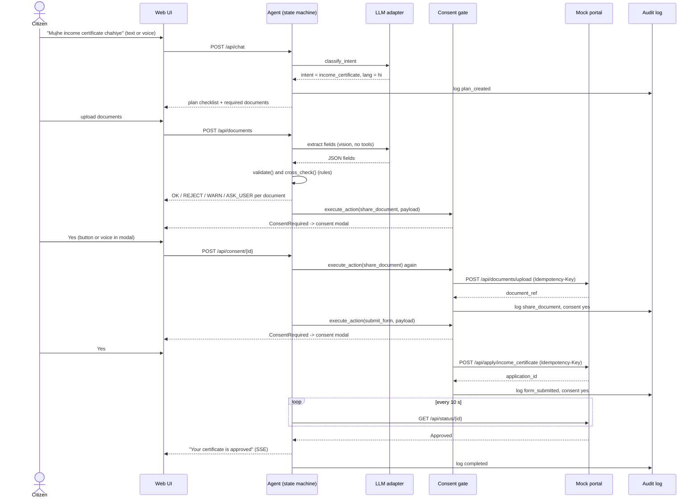
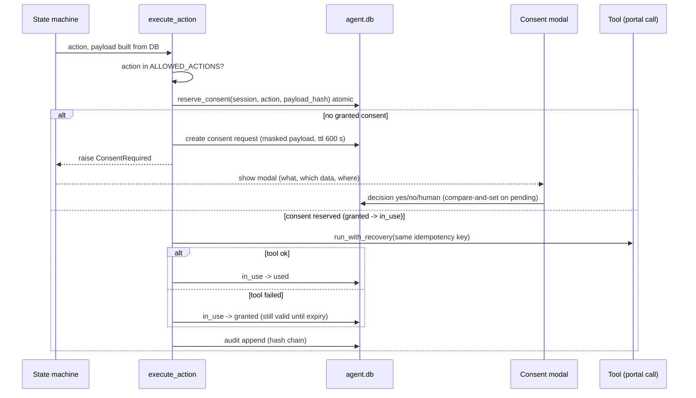
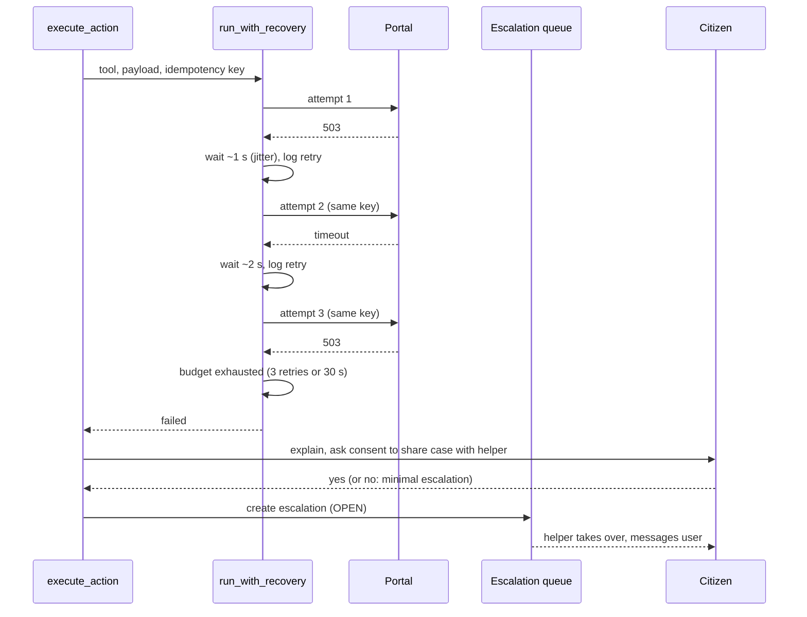
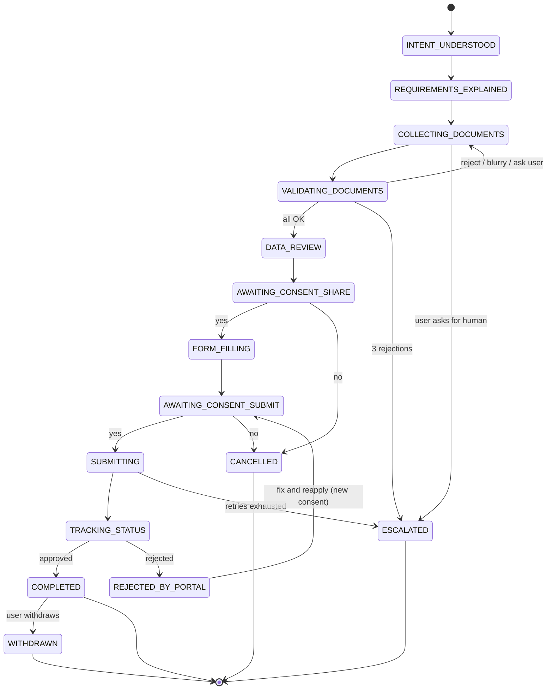
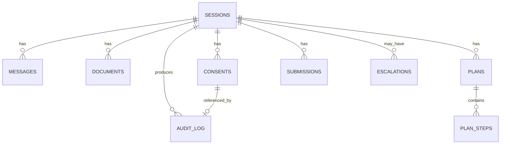
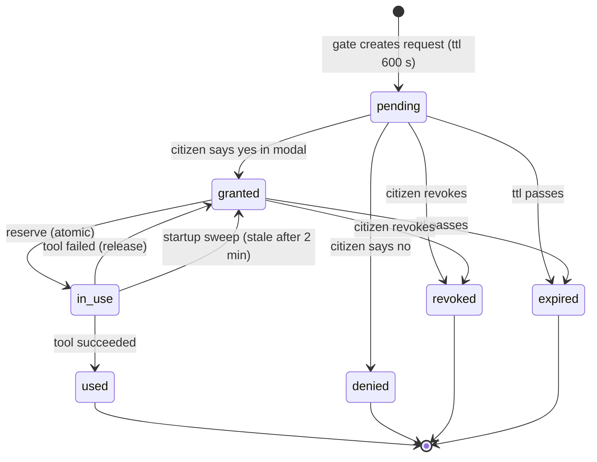
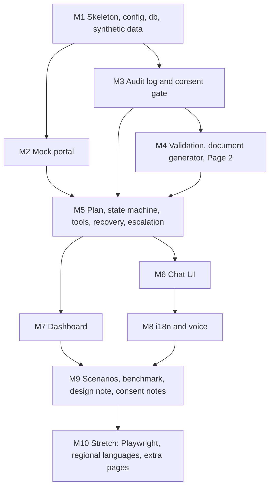

# ARCHITECTURE: Citizen-Service Agent

**Companion to:** `PRD_Citizen_Service_Agent.md` (v1.1 and later). The PRD says *what* to build; this file says *how it is structured*. If the two ever disagree, the PRD wins for behaviour and this file wins for structure; fix the disagreement instead of guessing.
**Audience:** Antigravity (coding agent) and human reviewers.
**Status:** v1.0 (Hackathon MVP)

---

## 0. How to use this file

1. Read the PRD first, then this file, before writing any code.
2. Build in the order of Section 21. Do not start a layer before the layer below it passes its tests.
3. Respect the **dependency rules** in Section 4.2. They exist so that the consent gate, audit log and validation can never be bypassed by the LLM.
4. Anything marked **[MVP]** is mandatory; **[STRETCH]** only after all MVP items work.
5. Every external dependency has a fallback (Section 17). The demo must never depend on a single external service.

---

## 1. Architectural principles

| # | Principle | Consequence in the design |
|---|---|---|
| P1 | **The LLM proposes, code disposes** | The LLM can only name an action from `ALLOWED_ACTIONS` and phrase text. Consent, validation, retry, escalation and plan invariants are deterministic code |
| P2 | **Consent is a hard gate in code** | Every sensitive tool call passes through `execute_action()`. There is no other path to a sensitive tool |
| P3 | **Validation by rules, extraction by LLM** | The vision model only extracts fields to JSON. Python rules decide valid, invalid or ask-the-user |
| P4 | **Everything is recorded, nothing is rewritten** | Append-only audit log with a hash chain and an anchor; no UPDATE or DELETE on it |
| P5 | **Idempotent side effects** | Every state-changing call carries a deterministic idempotency key; retries and crash-resume cannot duplicate a submission |
| P6 | **Explicit plan, versioned** | The agent executes a visible plan and replans with logged versions; invariants protect consent and validation steps |
| P7 | **Fail soft, then hand over** | Retry, alternate path, then escalate to a human. The citizen is never left stranded |
| P8 | **Synthetic data only, mock portal only** | No real identities and no real government endpoints anywhere in the system |
| P9 | **Deterministic where it matters** | Injectable clock, seeded RNG, stub LLM mode and sidecar extraction make tests reproducible |
| P10 | **Simple over clever** | SQLite, FastAPI, vanilla JS, an explicit state machine. No framework that hides control flow |

---

## 2. System context

```
                         +---------------------------+
                         |       Citizen (phone)     |
                         |   text / voice, Hi / En   |
                         +-------------+-------------+
                                       |
                                       v
 +--------------------------------------------------------------------+
 |                       AGENT BACKEND (FastAPI :8000)                |
 |                                                                    |
 |  Web UI (static)        API routes            Dashboard (helper)   |
 |  chat / documents       /api/*                /dashboard           |
 |        |                   |                         |             |
 |        +-------------------+-------------------------+             |
 |                            v                                       |
 |   +-------------------- AGENT CORE ---------------------------+    |
 |   |  Plan  ->  State machine  ->  LLM adapter (proposes)      |    |
 |   |                 |                                         |    |
 |   |                 v                                         |    |
 |   |   execute_action()  = CONSENT GATE (code, hard block)     |    |
 |   |                 |                                         |    |
 |   |                 v                                         |    |
 |   |   Tools: validate / fill / share / submit / status        |    |
 |   |   Recovery (retry, alternate, escalate)                   |    |
 |   +-----------+------------------------------+----------------+    |
 |               |                              |                     |
 |        Audit log (hash chain)           agent.db (SQLite, WAL)     |
 +---------------+------------------------------+---------------------+
                 |                              |
        HTTP (httpx, 8 s timeout)               |
                 v                              v
 +-----------------------------+      +-------------------------------+
 |  MOCK GOV PORTAL (:8001)    |      |  External services (optional) |
 |  forms, API, status, fail   |      |  Claude API (LLM + vision)    |
 |  modes, portal.db           |      |  Whisper (local or API)       |
 +-----------------------------+      |  Bhashini (STRETCH)           |
                                      |  Playwright (STRETCH)         |
                                      +-------------------------------+
```

**Containers** (separately runnable processes):

| Container | Tech | Port | Owns |
|---|---|---|---|
| Agent backend (includes citizen UI and helper dashboard) | FastAPI + Uvicorn | 8000 | `agent.db`, uploaded files, audit log |
| Mock government portal | FastAPI + Uvicorn | 8001 | `portal.db`, mock certificates |
| Browser clients | HTML, CSS, vanilla JS | n/a | Nothing persistent except UI preferences |

The dashboard is **served by the agent backend** (same origin, same database), which avoids CORS and keeps one auth model.

---

## 3. Deployment topology and startup

Single machine, three processes, started by `run.sh`:

1. Portal starts first (`uvicorn portal.main:app --port 8001`).
2. `run.sh` polls `GET http://localhost:8001/api/health` until healthy (timeout 30 s).
3. Agent backend starts (`uvicorn agent.main:app --port 8000`). If the portal is unreachable and `TEST_MODE` is off, it refuses to start with a clear error.
4. On start-up the agent backend runs a **recovery sweep**: release consents stuck in `in_use` for more than 2 minutes back to `granted`, and reload sessions that were mid-run.

Run modes:

| Mode | How | Purpose |
|---|---|---|
| Demo | default | Real LLM, vision extraction, real timers (30 s and 60 s status steps) |
| Test | `TEST_MODE=1` | Frozen clock, seeded portal RNG, sidecar extraction, forced immediate portal outcomes, consent auto-answered but still logged |
| Stub | `LLM_MODE=stub` | Deterministic scripted LLM, used for consent, hash-chain, recovery and tamper tests |
| Benchmark | `BENCHMARK_MODE=1` | Enables ablation flags; refused otherwise |

---

## 4. Module architecture (agent backend)

### 4.1 Modules and responsibilities

| Layer | Module | Responsibility | Key interface |
|---|---|---|---|
| 0 | `config.py` | Load and validate environment variables | `settings` |
| 0 | `clock.py` | Single source of time; freezable | `now_iso()`, `today()` |
| 0 | `util.py` | Canonical JSON, SHA-256, masking | `canonical()`, `sha256_hex()`, `mask()` |
| 1 | `db.py` | SQLite connections (WAL, busy timeout), transactions, repositories | `transaction(immediate=True)`, repo functions |
| 1 | `audit.py` | Hash-chained append-only log, verify, anchor | `append()`, `verify_chain()`, `log()` |
| 2 | `consent.py` | Consent requests, reserve/use/release, receipts, revoke | `execute_action()`, `ConsentRequired` |
| 2 | `validation.py` | Rule engine for documents and cross-checks | `validate()`, `cross_check()` |
| 2 | `i18n.py` | Fixed strings in `en` and `hi`, consent wording templates | `t(key, lang, **vars)` |
| 3 | `portal_client.py` | Async HTTP client for the mock portal (timeouts, idempotency headers) | `upload_document()`, `apply()`, `status()`, `withdraw()` |
| 3 | `extraction.py` | Document image to fields (vision or sidecar) | `extract(file, expected_type)` |
| 3 | `recovery.py` | Retry policy, alternate paths, escalation triggers | `run_with_recovery()`, `escalate()` |
| 3 | `voice.py` | Audio conversion and speech-to-text | `transcribe(audio, lang)` |
| 4 | `plan.py` | Plan creation, replanning, invariants | `create_plan()`, `replan()`, `validate_plan()` |
| 4 | `tools.py` | Tool implementations behind `execute_action()` | `validate_document`, `fill_form`, `share_document`, `submit_form`, `check_status`, `withdraw_application` |
| 5 | `llm.py` | Claude adapter: intent, wording, extraction, plan-edit proposals; stub mode | `classify_intent()`, `compose_reply()`, `propose_plan_edit()` |
| 5 | `state_machine.py` | Runs plan steps, persists state, handles global commands | `advance(session, event)` |
| 6 | `main.py`, `routes/*.py` | HTTP API, SSE, auth, static pages, dashboard | FastAPI app |

### 4.2 Dependency rules (enforced by a test)

```
main/routes -> state_machine -> {plan, tools, llm, recovery}
tools       -> {consent, validation, extraction, portal_client, audit}
consent     -> {db, audit, util}           (never imports llm)
audit       -> {db, util, clock}           (never imports llm)
validation  -> {util, clock, data files}   (never imports llm)
llm         -> {config, util}              (never imports consent, audit, db)
```
- Imports only go **downward** (higher layer number may import lower numbers, never the reverse).
- `consent.py`, `audit.py` and `validation.py` must **not** import `llm.py`. A unit test (`tests/test_architecture.py`) parses imports and fails the build if this is violated.
- The LLM adapter has no database handle and no tool handles. It receives plain data and returns plain data.

### 4.3 The single execution path for actions

```
LLM proposal (name + args)
   -> state_machine checks: action in ALLOWED_ACTIONS and legal next plan step
   -> state_machine builds the payload FROM DATABASE DATA (never from LLM text)
   -> execute_action(session, action, payload, tool_fn)
        -> consent gate (if sensitive)
        -> run_with_recovery(tool_fn, payload, idempotency_key)
        -> audit.log(...)
```
No route, tool or LLM output may call a sensitive tool function directly.

---

## 5. Runtime flows

### 5.1 End-to-end happy path



### 5.2 Consent gate in detail



### 5.3 Failure, retry, escalation



### 5.4 Other flows (summary)

| Flow | Path |
|---|---|
| **Voice input** | Browser MediaRecorder (webm/opus) -> `POST /api/stt` -> ffmpeg to 16 kHz mono WAV -> Whisper -> text -> same pipeline as chat. Fallback: browser Web Speech API |
| **Voice consent** | Mic button inside the consent modal only; transcript and confidence stored in the receipt; low confidence requires repeat or button press |
| **Status tracking** | State machine polls `GET /api/status/{id}` every 10 s (demo); pushes changes to the UI via SSE; rejection triggers a replan and a new consent for reapply |
| **Crash and resume** | On restart: reload latest plan version, first non-`done` step; resend with the same idempotency key from the write-ahead `submissions` row; sweep stale `in_use` consents |
| **Withdrawal** | User asks to withdraw -> consent for `withdraw_application` -> `POST /api/applications/{id}/withdraw` -> state `WITHDRAWN` -> audit |
| **Helper takeover** | Dashboard `Take over` -> helper sees case (full detail only if citizen consented) -> messages the citizen -> `Resolve` -> all logged with `actor=helper` |

---

## 6. State machine and plan

### 6.1 Macro states (PRD Section 13.1)



Global commands (handled in every state): stop, change language, talk to a human, "my consents", "download case report".

### 6.2 Plan (PRD Section 13.4)

- The plan is created by `plan.create_plan()` from the service template in `data/services.json` (deterministic, no LLM).
- Plan steps: `collect_document`, `recollect_document`, `confirm_name`, `validate_all`, `data_review`, `consent`, `submit_form`, `track_status`, `fix_issue`, `wait_and_retry`, `escalate`.
- The state machine executes the **next legal plan step**. Anything else is refused.
- `replan()` applies rule-based changes first; the LLM may propose an edit via `propose_plan_edit()`, which `validate_plan()` accepts only if the invariants hold:
  1. a `consent` step always precedes its sensitive step,
  2. `validate_all` precedes `submit_form`,
  3. no consent or validation step may be removed or skipped.
- Every plan version stores `reason` and a diff and writes `plan_created` or `plan_replanned` to the audit log.
- At most 3 replans per step, then escalate.

---

## 7. Data architecture

### 7.1 `agent.db` (SQLite, WAL mode)

```sql
CREATE TABLE sessions (
  id TEXT PRIMARY KEY,             -- UUID4, also in HttpOnly cookie
  language TEXT NOT NULL, state TEXT NOT NULL, service TEXT,
  created_at TEXT NOT NULL, updated_at TEXT NOT NULL, context_json TEXT
);
CREATE TABLE messages (
  id INTEGER PRIMARY KEY AUTOINCREMENT, session_id TEXT NOT NULL,
  role TEXT NOT NULL CHECK (role IN ('user','agent','helper','system')),
  text TEXT NOT NULL, lang TEXT, created_at TEXT NOT NULL
);
CREATE TABLE documents (
  id INTEGER PRIMARY KEY AUTOINCREMENT, session_id TEXT NOT NULL, slot TEXT NOT NULL,
  file_path TEXT NOT NULL, extracted_json TEXT, status TEXT, reason_code TEXT,
  attempt_no INTEGER NOT NULL DEFAULT 1, created_at TEXT NOT NULL
);
CREATE TABLE consents (
  id TEXT PRIMARY KEY, session_id TEXT NOT NULL, action TEXT NOT NULL,
  payload_json TEXT NOT NULL,       -- MASKED summary only
  payload_hash TEXT NOT NULL, data_fields TEXT, destination TEXT, purpose TEXT,
  language TEXT, method TEXT CHECK (method IN ('button','voice')),
  transcript TEXT, confidence REAL,
  status TEXT NOT NULL CHECK (status IN
    ('pending','granted','in_use','denied','revoked','expired','used')),
  expires_at TEXT NOT NULL, created_at TEXT NOT NULL, decided_at TEXT, audit_row_hash TEXT
);
CREATE TABLE audit_log (
  id INTEGER PRIMARY KEY AUTOINCREMENT,
  timestamp TEXT NOT NULL, session_id TEXT, application_id TEXT,
  actor TEXT NOT NULL CHECK (actor IN ('agent','user','helper','system')),
  action TEXT NOT NULL, reason TEXT, consent_status TEXT, result TEXT,
  payload_summary TEXT, prev_hash TEXT NOT NULL, row_hash TEXT NOT NULL
);
CREATE TABLE audit_anchor (id INTEGER PRIMARY KEY CHECK (id = 1), hash TEXT NOT NULL, count INTEGER NOT NULL);
CREATE TABLE escalations (
  id INTEGER PRIMARY KEY AUTOINCREMENT, session_id TEXT NOT NULL, user_ref TEXT,
  reason TEXT NOT NULL, retry_count INTEGER DEFAULT 0,
  status TEXT NOT NULL CHECK (status IN ('OPEN','IN_PROGRESS','RESOLVED')),
  created_at TEXT NOT NULL, assigned_helper TEXT, resolved_at TEXT, notes TEXT,
  detail_shared INTEGER NOT NULL DEFAULT 0   -- 1 only if citizen consented to share_with_helper
);
CREATE TABLE submissions (
  id INTEGER PRIMARY KEY AUTOINCREMENT, session_id TEXT NOT NULL,
  idempotency_key TEXT NOT NULL UNIQUE, application_id TEXT,
  status TEXT NOT NULL, created_at TEXT NOT NULL            -- written BEFORE the call (write-ahead)
);
CREATE TABLE plans (
  id INTEGER PRIMARY KEY AUTOINCREMENT, session_id TEXT NOT NULL, service TEXT NOT NULL,
  version INTEGER NOT NULL, reason TEXT, diff_json TEXT, created_at TEXT NOT NULL,
  UNIQUE (session_id, version)
);
CREATE TABLE plan_steps (
  id INTEGER PRIMARY KEY AUTOINCREMENT, plan_id INTEGER NOT NULL, seq INTEGER NOT NULL,
  type TEXT NOT NULL, slot TEXT, action TEXT,
  status TEXT NOT NULL CHECK (status IN ('pending','in_progress','done','failed','blocked','skipped')),
  attempt INTEGER NOT NULL DEFAULT 0, updated_at TEXT NOT NULL
);
```
Rules: **no UPDATE or DELETE on `audit_log`** anywhere in the code. `audit_log` and `audit_anchor` are written only through `audit.append()`.

### 7.2 `portal.db` (separate process, separate file)

```sql
CREATE TABLE applications (
  id TEXT PRIMARY KEY, idempotency_key TEXT NOT NULL UNIQUE, form_json TEXT NOT NULL,
  document_refs TEXT, created_at TEXT NOT NULL, forced_outcome TEXT,   -- test mode
  rejection_reason TEXT, withdrawn_at TEXT
);
CREATE TABLE portal_documents (
  ref TEXT PRIMARY KEY, idempotency_key TEXT NOT NULL UNIQUE, file_path TEXT NOT NULL, created_at TEXT NOT NULL
);
CREATE TABLE fail_counters (idempotency_key TEXT PRIMARY KEY, calls INTEGER NOT NULL);
```
The portal derives status **lazily from `created_at`** when read: +30 s `Under Review`, +60 s `Approved` or `Rejected`. No background threads. It reads `data/citizens.json` read-only.

### 7.3 Files

| Path | Content |
|---|---|
| `data/citizens.json` | 20+ synthetic citizens |
| `data/services.json` | Service template: required documents, per-document `max_age_days`, form fields, plan template |
| `data/docs/` | Generated fake documents (good, wrongname, blurry, expired, wrongtype, unknown) plus sidecar JSON |
| `data/fonts/` | TrueType fonts (Noto Sans and Noto Sans Devanagari) |
| `uploads/` | Citizen uploads, random file names, EXIF stripped |
| `reports/` | `results.md/json`, `benchmark.md/json/png` |

### 7.4 Entity relationships



---

## 8. Consent architecture

### 8.1 Sensitive actions

`share_document`, `submit_form`, `make_payment`, `reapply`, `share_with_helper`, `withdraw_application`.

### 8.2 Consent lifecycle



### 8.3 Binding and identifiers

| Item | Definition |
|---|---|
| `payload_hash` | `sha256(canonical(payload))`. Payload holds **stable fields only** (no timestamps, no random ids) and is built by code from database data |
| Consent binding | `(session_id, action, payload_hash)`; changing any field invalidates it and a new request is created |
| Idempotency key | `sha256(session_id : action : payload_hash)`; deterministic, so retries and resume reuse it |
| Decision write | `UPDATE consents SET status=? WHERE id=? AND status='pending'` (a double click cannot decide twice) |
| Reservation | `UPDATE ... SET status='in_use' WHERE ... AND status='granted' AND expires_at > now` returns the row or nothing |
| Stored payload | Masked summary (for example `XXXX XXXX 9012`); only the hash is needed for binding |
| What counts | Only a decision inside the consent modal (button or in-modal voice). Chat text, document contents and LLM output never count |
| UX | Yes and No have equal weight, no default focus on Yes, the consequence of No is stated, no countdown pressure |

### 8.4 Consent receipts and withdrawal

Each decision creates a receipt (`consent_id, action, data_fields, destination, purpose, language, method, decision, timestamp, expiry, audit_row_hash`). "My consents" reads receipts from the database, never from LLM memory. Revoke applies to pending or unused consents; withdrawal after sharing needs a new consent for `withdraw_application` and calls the portal withdraw endpoint.

---

## 9. Audit log architecture

```
 audit.append(row)
   BEGIN IMMEDIATE                       <- one writer at a time; chain cannot fork
   prev  = last row_hash or "GENESIS"
   row.timestamp = clock.now_iso()       <- UTC
   row.prev_hash = prev
   row.row_hash  = sha256(canonical({HASHED_FIELDS}))
   INSERT audit_log                      <- id is assigned by DB and is NOT hashed
   UPDATE audit_anchor SET hash=row_hash, count=count+1
   COMMIT
```

- `HASHED_FIELDS = timestamp, session_id, application_id, actor, action, reason, consent_status, result, payload_summary, prev_hash`.
- `verify_chain()` walks rows by `id`, recomputes each hash, checks `prev_hash` continuity, then compares the final hash and count with `audit_anchor` (detects deleted tail rows).
- The **chain head hash and count** are shown on the dashboard and in each case report so an auditor can compare with an earlier copy.
- Logged actions include: `plan_created`, `plan_replanned`, `document_validated`, `consent_requested`, `consent_granted`, `consent_denied`, `consent_revoked`, `form_filled`, `share_document`, `form_submitted`, `status_checked`, `retry`, `escalated`, `helper_takeover`, `resolved`, `withdrawn`.
- Aadhaar numbers are masked in every log row. Raw images are never logged.
- **Case report** (`GET /api/cases/{session_id}/report`): ordered actions, consent receipts, failures and recoveries, escalation, helper actions, chain verification result and head hash. HTML or JSON, in the citizen's language.

---

## 10. Recovery and escalation architecture

### 10.1 Error classification

| Error | Class | Retry | Alternate path | Escalate |
|---|---|---|---|---|
| Timeout, connection error | Transient | Yes (max 3, backoff 1, 2, 4 s with jitter, 30 s budget) | Wait and retry later | After budget is exhausted |
| HTTP 5xx, 429 | Transient | Yes (same idempotency key) | Playwright UI path [STRETCH] | After budget is exhausted |
| HTTP 4xx (validation) | Permanent | **No** | Fix input or ask the citizen | If the same document fails 3 times |
| Vision API failure or bad JSON | Transient | Once (after schema check) | Sidecar or manual field entry | If manual entry also fails |
| Speech recognition failure | Transient | Once | Ask the citizen to type or repeat | No |
| Unexpected exception | Bug | No | Friendly message | Yes (escalate and log) |

### 10.2 Escalation triggers

1. Portal call fails after the retry budget.
2. Same document rejected 3 times.
3. Citizen asks for a human (keyword detection in Hindi and English **and** LLM intent).
4. Intent still `unknown` after 3 clarification attempts (no reliance on LLM self-reported confidence).
5. Unexpected exception in the state machine.
6. More than 3 replans for the same plan step.

### 10.3 Escalation flow

1. Agent explains the problem and asks consent for `share_with_helper`.
2. Yes: escalation created with `detail_shared = 1`, helper sees full history.
3. No: escalation is **still created** with only case ID, reason code and language; the helper contacts the citizen and may ask for consent again.
4. Helper takes over, messages the citizen, marks resolved. Every step is logged with `actor=helper`.

### 10.4 Write-ahead submission

Before any state-changing call: insert `submissions(idempotency_key, status='pending')`. After the call: update it. On resume: resend with the same key; the portal's unique constraint on `idempotency_key` returns the same application, so duplicates are impossible.

---

## 11. LLM integration architecture

### 11.1 What the LLM does and does not do

| Allowed | Not allowed |
|---|---|
| Classify intent and language | Execute any tool |
| Phrase replies and explanations in the citizen's language | Create or imply consent |
| Extract fields from a document image to JSON (no tools) | Build the payload of a sensitive action |
| Propose a plan edit using allowed step types | Add, remove or reorder consent or validation steps |
| Detect "talk to a human" intent | Decide whether a document is valid |

### 11.2 Calls

| Call | Input | Output | Safeguards |
|---|---|---|---|
| `classify_intent` | Last user message, language, state | `{intent, language, wants_human}` | Schema validated; unknown intent counted toward escalation |
| `compose_reply` | State, plan, validation results, language | Reply text | Receives facts from code; cannot claim a step is done unless the tool result confirms it |
| `extract` | Image or PDF | Fields JSON or `{"readable": false}` | **No tools**, fixed system prompt, output parsed as data only, pydantic schema, fences stripped, one retry then manual entry. Images resized to at most 1568 px on the long edge |
| `propose_plan_edit` | Plan, failure context | Edit with allowed step types | `validate_plan()` rejects anything breaking invariants |

### 11.3 Trust boundaries for prompt injection

- Text inside documents, chat messages and helper messages is **untrusted data**. It never changes system instructions, never creates consent and never selects a tool outside `ALLOWED_ACTIONS`.
- The extraction call is isolated from the conversational prompt; extracted text is never pasted into the agent's instructions.
- Benchmark scenario S20 (prompt injection) must show the gate holding.

### 11.4 Configuration

`CLAUDE_MODEL` (default `claude-sonnet-5-5`) read from the environment; async client; lowest-variance settings in test and benchmark runs. `LLM_MODE=live|stub`: the stub is a deterministic scripted adapter used by every test that must not depend on model output (S08, S09, S18, S19, S20, consent, hash-chain, recovery tests).

---

## 12. Multilingual and voice architecture

```
Mic -> MediaRecorder (webm/opus) -> POST /api/stt -> ffmpeg (16 kHz mono WAV) -> Whisper -> text
                                                                         |
                                       fallback: browser Web Speech API  v
Text -> language detect (first message) -> chat pipeline -> reply text (hi or en)
Reply text -> speaker toggle on -> browser speechSynthesis (hi-IN / en-IN)
           -> no Hindi voice available -> show text and a notice, never fail silently
```

- Fixed UI strings, consent wording and rejection reasons come from `i18n.py` (`en`, `hi`); LLM text is only used for free-form explanation.
- **[STRETCH]** Bhojpuri and Maithili through Bhashini when keys exist; otherwise Hindi.
- Microphone needs a secure context (`https` or `localhost`). Consent questions are always read aloud when voice mode is on.
- Devanagari rendering needs a Devanagari font in both the web UI and the Pillow document generator.

---

## 13. API architecture

The full endpoint list is in the PRD (Sections 16 and 17). Structural rules:

| Concern | Rule |
|---|---|
| Sessions | `session_id` is an unguessable UUID4 in an HttpOnly cookie; the path parameter must match the cookie |
| CSRF | State-changing requests carry a per-session CSRF token header |
| Helper access | `/api/escalations/*`, `/api/audit*`, `/dashboard` require the helper token or password |
| Validation | Every request body has a pydantic schema; unknown fields are rejected |
| Real-time | SSE at `GET /api/stream/{session_id}`: heartbeat every 15 s, `Last-Event-ID` reconnect, never blocked by slow tool calls |
| Uploads | JPG, PNG, PDF only; real type by magic bytes; max 5 MB; random file names; EXIF stripped |
| Portal calls | `httpx.AsyncClient`, 8 s timeout, `Idempotency-Key` on every mutating call |
| Errors | Typed errors to the UI with a user-language message; no stack traces to the citizen |

---

## 14. Frontend architecture

Static HTML, CSS and vanilla JS, mobile-first (usable at 360 px), served by the agent backend; the portal serves its own two pages.

| Page | Route | JS modules |
|---|---|---|
| Chat (Page 1) | `/` | `api.js`, `sse.js`, `chat.js`, `voice.js`, `consent_modal.js`, `plan_panel.js`, `i18n.js` |
| Documents (Page 2) | `/documents` | `api.js`, `documents.js`, `i18n.js` |
| Portal form (Page 3) | `/portal/apply` (port 8001) | plain form script |
| Portal status (Page 4) | `/portal/status` (port 8001) | polling script |
| Dashboard (Page 5) | `/dashboard` | `api.js`, `dashboard.js` (audit table, verify button, escalation table, case detail) |

Key UI components:
- **Consent modal:** non-dismissible; shows what, which data, where; Yes, No and Talk to a human with equal weight; in-modal "Say Yes / No" mic button.
- **Plan panel:** collapsible checklist; new steps highlighted after a replan; progress bar computed from the plan.
- **My consents** list with Revoke or Withdraw; **Download case report** link.
- **Result cards** on the Documents page: OK, REJECT, WARN, with reason and attempt counter ("Attempt 2 of 3").

[STRETCH] Pages 6 and 7 (agent Status page, full-screen Consent screen) and Pages 8 and 9 (portal service list, split dashboard) per PRD Section 4.2.

---

## 15. Security, privacy and trust zones

| Zone | Trusted? | Notes |
|---|---|---|
| Browser | Untrusted | All input validated server-side; consent decisions authenticated by session cookie and CSRF token |
| LLM output | Untrusted | Treated as proposals; schema-validated; never executes tools |
| Document contents | Untrusted | Data only; isolated extraction call |
| Agent backend code (gate, audit, validation) | Trusted | Layering enforced by tests |
| Mock portal | Semi-trusted | Separate process; failures are expected and handled |
| Helper | Authenticated | Sees full case detail only if the citizen consented |
| Database | Trusted but tamper-evident | Hash chain plus anchor |

Privacy rules: all data synthetic with a visible DEMO watermark; Aadhaar masked in logs and stored consent payloads; raw images not logged; `ANTHROPIC_API_KEY` only from the environment, never logged, `.env` never committed; demo data deleted on reset.

---

## 16. Concurrency and async rules

1. No blocking calls (`requests`, sync SQLite, Whisper, sync Anthropic client) inside `async def` handlers; use async clients or a thread pool.
2. SQLite: WAL mode, busy timeout, one connection per request or thread, `BEGIN IMMEDIATE` for audit append and consent state changes.
3. Time: UTC only; all code reads time from `clock`.
4. Atomic transitions: consent decision and reservation use compare-and-set updates.
5. Idempotency before side effects: write the `submissions` row first.
6. The portal stores the idempotency key (unique constraint) **before** processing, so a slow first request and its retry return the same result.

---

## 17. Configuration and flags

| Variable | Values | Purpose |
|---|---|---|
| `ANTHROPIC_API_KEY` | secret | Claude API |
| `CLAUDE_MODEL` | default `claude-sonnet-5-5` | Model name |
| `LLM_MODE` | `live` or `stub` | Real model or deterministic stub |
| `EXTRACTION_MODE` | `vision` or `sidecar` | Fallback if vision is slow or unavailable |
| `PORTAL_BASE_URL` | `http://localhost:8001` | Portal address |
| `PORTAL_FAIL_MODE` | `none, random, down, slow, reject_income, fail_n:<k>` | Failure simulation |
| `PORTAL_SEED` | integer | Seeded randomness for `random` mode |
| `TEST_MODE` | `0` or `1` | Frozen clock, immediate outcomes, scripted consent |
| `REFERENCE_DATE` | ISO date | Date base for generated documents and frozen clock |
| `WHISPER_MODE` | `local`, `api`, `browser` | Speech-to-text source |
| `BHASHINI_*` | optional | Regional languages [STRETCH] |
| `BENCHMARK_MODE` | `0` or `1` | Must be `1` to enable ablations |
| `ABLATE_RECOVERY`, `ABLATE_CODE_CONSENT`, `ABLATE_RULES` | `0` or `1` | Benchmark ablations; refused unless `BENCHMARK_MODE=1` |
| `HELPER_TOKEN` | secret | Dashboard and helper API access |

Fallback table:

| Primary | Fallback |
|---|---|
| Claude vision extraction | Sidecar JSON, then manual field entry |
| Whisper | Browser Web Speech API, then typing |
| `speechSynthesis` Hindi voice | Show text with a notice |
| Portal API | Playwright UI path [STRETCH], then wait and retry, then escalate |
| Bhashini | Hindi |

---

## 18. Testing architecture

| Level | What | How |
|---|---|---|
| Architecture | Dependency rules (Section 4.2) | `tests/test_architecture.py` parses imports |
| Unit | Consent gate blocks without consent; payload change invalidates consent; retry reuses the same consent; double click on Yes consumes it once; hash chain after 100 sequential and 20 concurrent appends; edit and delete detected; Aadhaar and ration cards not rejected as expired; old income proof rejected; "Rik K." gives `ASK_USER`; plan invariants hold | `tests/test_core.py` with `LLM_MODE=stub` |
| Scenario | 20 scenarios S01 to S20 from the PRD with expected terminal outcomes | `scripts/run_scenarios.py` (scripted turns, forced portal modes, frozen clock, auto-consent still logged) |
| Benchmark | Tiered short, medium and long tasks, 3 seeds, ablations A to D, replan correctness, citizen-effort and cost metrics | `benchmarks/run_benchmark.py --seeds 3 --ablations` |
| Tamper demo | Edit one audit row, verify fails | `scripts/tamper_demo.py` |

**Success** means the correct terminal state: Approved when solvable, or a correct escalation or consent-denied stop when not. Silent failure, wrong completion or any consent violation counts as failure. Targets: 0 consent violations, 100% audit completeness.

---

## 19. Observability

- Structured server logs (JSON lines) with `session_id`, `action`, `attempt`, latency; separate from the audit log (the audit log is evidence, server logs are for debugging).
- Dashboard shows chain verification status, head hash, escalation counts and last portal health.
- Benchmark outputs store the audit-log slice of every run for inspection.

---

## 20. Directory map

Identical to PRD Section 7, with these architecture-specific additions:

```
citizen-agent/
|-- agent/
|   |-- config.py, clock.py, util.py            # layer 0
|   |-- db.py, audit.py                         # layer 1
|   |-- consent.py, validation.py, i18n.py      # layer 2
|   |-- portal_client.py, extraction.py,
|   |   recovery.py, voice.py                   # layer 3
|   |-- plan.py, tools.py                       # layer 4
|   |-- llm.py, state_machine.py                # layer 5
|   |-- main.py, routes/                        # layer 6
|-- portal/ , dashboard/ , web/ , data/ , scripts/ , benchmarks/ , reports/ , docs/
`-- tests/ (test_architecture.py, test_core.py, scenarios/)
```

---

## 21. Build order and dependencies



Gate rule: do not start a milestone until the previous one's tests pass. If time is short, finish M1 to M7 and M9 first, then voice and languages.

---

## 22. Architecture decisions

| Decision | Choice | Why | Trade-off |
|---|---|---|---|
| Orchestration | Explicit state machine plus versioned plan | Auditable, testable, resumable; no hidden control flow | More code than a framework |
| Consent enforcement | Code gate in `execute_action()` | Cannot be bypassed by prompts | Every tool must go through it |
| Validation | Python rules, LLM extracts only | Deterministic and explainable | Needs per-document rule code |
| Database | SQLite (WAL) | Zero setup, enough for a demo, transactional | Single-node only |
| Audit integrity | Hash chain plus anchor | Cheap, visible tamper evidence | Needs an external copy of the head hash for full assurance |
| Real-time | SSE | Simple, one-way push is enough | No client-to-server push (HTTP POST covers it) |
| Frontend | Vanilla JS, static files | Fast to build, mobile-friendly, no build step | Less structure than a framework |
| Portal | Separate process | Realistic failure modes (network, timeouts) | Extra process to start |
| Idempotency | Deterministic keys plus write-ahead row | Safe retries and crash-resume | Extra table and discipline |
| Dashboard hosting | Inside the agent backend | Same origin and DB, one auth model | Not independently deployable |
| Testing LLM-dependent logic | Stub mode | Reproducible consent and recovery tests | Stub must be kept in sync with the real adapter |

---

## 23. Theme and requirement traceability

| Hackathon theme or brief item | Architectural element |
|---|---|
| **AI Agents** | Agent core: plan, state machine, tool layer, LLM adapter (Sections 4, 6, 11) |
| **Civic Tech** | Mock portal, synthetic citizens, Hindi and English voice, mobile-first UI, no middlemen (Sections 2, 7, 12, 14) |
| **Long-Horizon Planning** | Versioned plan with replanning, write-ahead submissions, crash-resume, tiered benchmarks (Sections 6, 10, 18) |
| **Human-in-the-Loop** | Consent gate and receipts (Section 8), `ASK_USER` clarification, helper takeover (Section 10), audit and case report (Section 9) |
| Collects, validates, fills, tracks | `extraction`, `validation`, `tools`, `portal_client`, status polling (Sections 4, 5) |
| Explicit consent and full audit log | `consent.py`, `audit.py` (Sections 8, 9) |
| Failure recovery and escalation | `recovery.py`, escalation queue (Section 10) |
| Working agent on mock portal | Portal container and failure modes (Sections 2, 7.2, 17) |
| Long-horizon benchmarks | `benchmarks/` and scenario runner (Section 18) |
| Consent notes and design note | `docs/consent_notes.md`, `docs/design_note.md` (PRD Section 20) |

---

## 24. Limitations and extension points

**Limitations (state them honestly in the design note):** mock portal and synthetic identities only; demo-level authentication; LLM extraction can misread documents (hence rule validation and citizen review); limited languages; the hash chain needs an externally saved head hash to detect removal of newest rows together with the anchor; single-node SQLite.

**Extension points:** new services via `services.json` and a plan template (scholarship is the first); `portal_client` adapter for other portals; regional languages through Bhashini; Playwright path for a visible form-filling demo; replacing SQLite with Postgres by swapping `db.py`.

---

## 25. Guardrails for the coding agent (Antigravity)

1. Never call a sensitive tool outside `execute_action()`.
2. Never build a sensitive payload from LLM text; build it from database data.
3. Never add UPDATE or DELETE statements for `audit_log`.
4. Never import `llm.py` from `consent.py`, `audit.py` or `validation.py`.
5. Never call blocking code in an `async def` handler.
6. Never retry HTTP 4xx; always reuse the same idempotency key and the same consent when retrying.
7. Never hash the `id` column in the audit chain.
8. Never use real personal data or real government endpoints.
9. Every new feature needs a test, and every failure path needs an audit entry.
10. When this file and the PRD disagree, stop and report the conflict instead of guessing.

*End of architecture file.*
