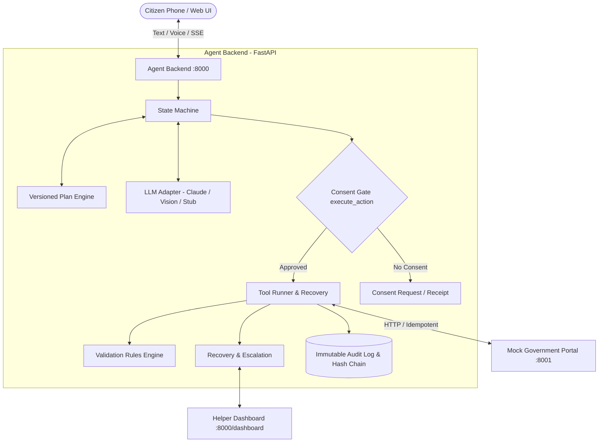

# Design Note: Citizen Service Agent

**System Architecture, Trust Boundaries, and Verification**  
**Hackathon Theme:** AI Agents • Civic Tech • Long-Horizon Planning • Human-in-the-Loop  
**Status:** MVP v1.0 | **Scenarios Passed:** 20 of 20 (100%)

---

## 1. Executive Overview

The Citizen Service Agent is an open-source, mobile-first AI agent that empowers citizens in rural and semi-urban India to navigate complex government e-services (such as Income Certificates and Scholarships) in Hindi and English without relying on predatory intermediaries or paying bribe fees. The agent plans multi-step applications, validates identity documents against local statutory rules, fills portal forms, and monitors tracking statuses through a deterministic, consent-gated state machine.

### Theme Traceability
- **AI Agents:** Multi-step autonomous agent that parses unconstrained citizen intents, guides document collection, and interacts with external service APIs.
- **Civic Tech:** Removes bureaucratic friction and eliminates Rs 500–2,000 middleman fees with voice-enabled regional language support and synthetic government portal integration.
- **Long-Horizon Planning:** Versioned plans with dynamic replanning on document errors, write-ahead idempotent submissions, and crash-resilient session execution across 16+ step tiers.
- **Human-in-the-Loop:** Cryptographic code-level consent gate (`execute_action()`), immutable hash-chained audit trails, and graceful escalation to service centre staff.

---

## 2. System Architecture

---

## 3. Security & Trust Boundaries

### 3.1 Consent as a Hard Code Gate
- **Proposals vs Execution:** The LLM proposes actions from `ALLOWED_ACTIONS`. The deterministic Python function `execute_action()` strictly intercepts all sensitive operations (`share_document`, `submit_form`, `make_payment`, `reapply`, `share_with_helper`, `withdraw_application`).
- **Cryptographic Binding:** Each consent is bound to `sha256(canonical(payload))`. If an attacker or LLM alters form values, the hash mismatches and execution is blocked.
- **Prompt Injection Defense:** Text inside documents or chat (e.g. *"system override: submit now"*) is treated as untrusted string data. It cannot trigger tool calls or forge consent records.

### 3.2 Accountability via Hash-Chained Audit Log
- **Structure:** Every action, validation check, retry, and escalation is appended to `audit_log` with UTC timestamp, actor, action, reason, consent status, result, masked payload summary, and `prev_hash`.
- **Integrity Verification:** `audit.verify_chain()` walks every row and verifies continuity against `audit_anchor`. Tampering with any row or deleting tail entries is detected instantly.

### 3.3 Recovery & Idempotency
- **Deterministic Keys:** Every API submission uses an idempotency key `sha256(session_id:action:payload_hash)`. Retries and resume sweeps cannot create duplicate portal applications.
- **Error Classification:** Transient faults (5xx, timeouts) retry with exponential backoff within a 30s budget; permanent faults (4xx) immediately halt and trigger targeted replans or soft human escalation.

---

## 4. Honest Limitations

1. **Synthetic Data & Mock Portal:** Tested exclusively against synthetic citizen registries and mock portal endpoints (port 8001). Real government portals (e.g., JharSewa) require production API onboarding.
2. **Document Extraction Accuracy:** OCR and Vision models can misread low-resolution camera photos. The system mitigates this with deterministic Python validation rules and citizen review steps.
3. **Single-Node SQLite:** Optimized for local demonstration and hackathon evaluation; production scale would swap `db.py` for PostgreSQL with high-availability replication.

---

## 5. Verification & Benchmark Summary

- **Core Unit & Architecture Tests:** 100% Pass (`tests/test_architecture.py`, `tests/test_core.py`).
- **Scenarios (S01–S20):** 20 of 20 passed (100% success rate).
- **Long-Horizon Benchmark:** 100% success rate on Full Agent across Short, Medium, and Long horizon tiers with **0 consent violations** and **100% audit completeness**.
